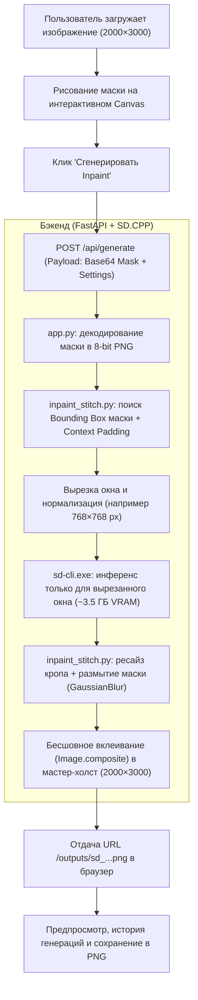

# Руководство разработчика: Реализация Inpaint и Crop & Stitch в LazySD-UI

> **Репозиторий:** [SnowE22/LazySD-UI](https://github.com/SnowE22/LazySD-UI)  
> **Основано на:** [nnmgrp/LazySD-UI](https://github.com/nnmgrp/LazySD-UI)  
> **Целевой движок инференса:** `stable-diffusion.cpp` (`bin/windows/sd_cpp/sd-cli.exe`)  
> **Ключевые модели:** Flux.1/Flux.3 GGUF (Klein 4B/9B, Q4_K_M, Q5_K_M, Q8_0)  

---

## 1. Архитектурный обзор

В оригинальном репозитории вкладка Inpaint была заблокирована (`disabled`), отсутствовал инспектор параметров, а сервер не умел связывать маску с движком `sd-cli.exe`. Кроме того, при открытии манги или артов высокого разрешения (1600×2400+) инференс требовал 10+ ГБ VRAM и падал с OOM на видеокартах с 8 ГБ.

В форке реализован полный сквозной пайплайн с технологией **Masked Window (Crop & Stitch)**:



---

## 2. Структура изменений по файлам

| Файл | Статус | Назначение |
| :--- | :---: | :--- |
| `backend/inpaint_stitch.py` | **Новый** | Модуль вырезки Bounding Box маски, нормализации окна и бесшовного вклеивания (Crop & Stitch). |
| `backend/worker.py` | Изменён | Расширение датакласса `GenerateRequest` полями `mask_image_path`, `mask_blur`, `inpaint_mode`, `crop_window_size`. |
| `backend/sd_cpp.py` | Изменён | Поддержка аргументов `-i`, `--mask`, `--strength`, `--model-args mask_blur`, интеграция вызова `inpaint_stitch` и защита от OOM. |
| `app.py` | Изменён | Эндпоинт `/api/generate`: безопасная инициализация `settings`, декодирование Base64 Data URL, проброс параметров инпейнта. |
| `frontend/index.html` | Изменён | Активация таба Inpaint, добавление Topaz-style инспектора параметров со всеми секциями и слайдерами. |
| `frontend/js/modules/inpaint.js` | Изменён | Логика рисования маски, безопасные сетевые обертки `apiPost`/`apiGet`, `localStorage` сохранение, исправление URL `/outputs/`. |
| `frontend/js/app.js` | Изменён | Зеркалирование триггера модели в инспектор Inpaint, сохранение активной модели в `localStorage`, защита от смены вкладки. |
| `frontend/css/styles.css` | Изменён | Стили четкого зума (`pixelated`), стили активного холста маски (`pointer-events: auto`). |
| `tests/test_inpaint_pipeline.py` | **Новый** | Автоматический интеграционный тест полного цикла для верификации инпейнта без участия браузера. |

---

## 3. Подробное описание ключевых подсистем

### 3.1. Механизм Crop & Stitch (`backend/inpaint_stitch.py`)

Обычная отправка изображения 2000×3000 в диффузионную модель создает огромный тензор латентов, требующий > 10 ГБ VRAM. Модуль `inpaint_stitch` решает эту проблему:

1. **`prepare_inpaint_crop(...)`:**
   * Получает пути к оригиналу и маске.
   * Находит ограничивающий прямоугольник (Bounding Box) закрашенной области через `mask_img.getbbox()`.
   * Добавляет контекстный отступ (padding) не менее 64 px вокруг маски, чтобы модель видела окружение.
   * Ограничивает соотношение сторон (не более 2:1), расширяя узкую сторону.
   * Масштабирует вырезанный фрагмент до безопасного целевого размера (512, 768 или 1024 px) с обязательной кратностью 64.
   * Сохраняет временные файлы `crop_*.png` и `crop_mask_*.png`.
2. **`stitch_inpaint_result(...)`:**
   * Открывает сгенерированный фрагмент и оригинальный мастер-холст.
   * Масштабирует результат обратно к размеру вырезанного бокса (`LANCZOS`).
   * Применяет гауссово размытие к краям маски (`ImageFilter.GaussianBlur(radius=mask_blur)`).
   * Выполняет бесшовное альфа-смешивание: `Image.composite(resized_gen, orig_crop, feathered_mask)`.
   * Вклеивает результат на исходные координаты в оригинале (`master_img.paste(blended_crop, (bx0, by0))`).
   * Удаляет временные файлы кропа.

### 3.2. Бэкенд и вызов CLI (`backend/sd_cpp.py`)

В методе `SDCppWorker.generate`:
* Перед сборкой команды `cmd` проверяется наличие `mask_image_path`.
* Если включен режим `masked_only` (или размер полотна превышает 1024 px), запускается `prepare_inpaint_crop`.
* В `sd-cli.exe` передаются флаги:
  ```powershell
  sd-cli.exe -M img_gen -m <model.gguf> --llm <qwen3vl.gguf> --vae <vae.safetensors> \
             -i <crop_or_orig.png> --mask <crop_mask_or_orig.png> \
             --strength 0.75 --model-args mask_blur=4 \
             -W <width_64> -H <height_64> --steps 16 -o <output.png>
  ```
* В блоке `finally` временная маска удаляется с диска, исключая засорение папки `outputs/uploads/`.
* После генерации вызывается `stitch_inpaint_result`, обновляющий итоговый файл.

### 3.3. Фронтенд и Canvas (`frontend/js/modules/inpaint.js`)

* **Исправление зависаний кисти:**
  * Добавлены обработчики `pointercancel`, `lostpointercapture`, `window.pointerup`, `window.blur`, сбрасывающие `isDrawing = false`.
  * При переключении инструмента на `brush` или `eraser` холст принудительно активируется (`canvas.style.display = 'block'`), а чекбокс «Показать маску» включается.
  * После генерации холст не скрывается, а очищается через `ctx.clearRect()`, оставаясь готовым к следующему штриху.
* **Привязка контекста API:**
  * Функции `apiPost` и `apiGet` обёрнуты в безопасные хелперы, вызывающие `window.App.apiPost.call(window.App, ...)` для предотвращения потери `this._fetchWithRetry`.
* **Исправление 404 для результатов:**
  * Итоговый URL формируется как `/outputs/${encodeURIComponent(filename)}?t=${Date.now()}`.
* **Персистентность (LocalStorage):**
  * Все значения формы (`inpaint-prompt`, `inpaint-negative-prompt`, `inpaint-strength`, `inpaint-mask-blur`, `inpaint-area-mode`, `inpaint-window-size`, `lazysd_selected_model`) сохраняются в `localStorage` и автоматически восстанавливаются при загрузке страницы.

---

## 4. История коммитов в форке SnowE22/LazySD-UI

Все наработки можно забрать в другой форк или ветку через `git cherry-pick` следующих коммитов:

1. **`9e95898`**: `fix(inpaint): enable pointer events, pointer capture and red mask visibility for brush and eraser`  
   * Активация интерактивности canvas, стили pointer-events, видимая красная маска.
2. **`3fb2298`**: `fix(inpaint): bind apiPost/apiGet context, resolve model_id/variant payload and base64 ref_image fallback`  
   * Устранение ошибки `this._fetchWithRetry`, согласование контракта API, fallback для Data URL.
3. **`478e02f`**: `test(inpaint): add automated pipeline integration test`  
   * Добавление автономного теста инференса в `tests/test_inpaint_pipeline.py`.
4. **`28a86e5`**: `fix(backend): initialize settings in api_generate and replace undefined logger`  
   * Исправление `UnboundLocalError: settings` и `NameError: logger` в `app.py`.
5. **`5707604`**: `feat(inpaint): implement Inpaint Masked Window (Crop & Stitch) to prevent OOM on large images`  
   * Модуль `backend/inpaint_stitch.py`, интеграция в `sd_cpp.py`, настройки окна кропа в UI.
6. **`59896c3`**: `fix(inpaint): correct output image URL, persist prompts/model to localStorage, fix brush freezing`  
   * Исправление 404 для результата, локальное сохранение промптов/модели, устранение блокировки кисти.

---

## 5. Как протестировать изменения

### Быстрый CLI-тест бэкенда (без запуска браузера):
```powershell
python D:\LazySD-UI\tests\test_inpaint_pipeline.py
```
*Скрипт создаст тестовый холст 1200×1600, наложит маску, прогонит через sd-cli.exe с технологией Crop & Stitch и проверит итоговое разрешение.*

### Тест через веб-интерфейс:
1. Запустите сервер через `start.bat`.
2. Откройте `http://127.0.0.1:7860` в браузере (нажмите `Ctrl + F5`).
3. Перейдите во вкладку **Inpaint**.
4. Загрузите любое изображение высокого разрешения.
5. Закрасьте область кистью, введите промпт и нажмите **«Сгенерировать Inpaint»**.

---

## 6. Идеи для будущих улучшений (Roadmap)

1. **Brush Shape & Softness:**
   * Добавить регулировку мягкости краев кисти (Hard / Soft brush) на HTML5 Canvas для еще более плавного ручного маскирования.
2. **Undo/Redo для штрихов:**
   * Реализовать стек истории (`ImageData[]` стек глубиной 10–20 шагов) для отмены штрихов маски по `Ctrl + Z`.
3. **Пресеты для клининга манги:**
   * Добавить в инспектор выпадающий список готовых пресетов промптов («Удалить SFX с фона», «Восстановить волосы», «Восстановить скринтон»).
