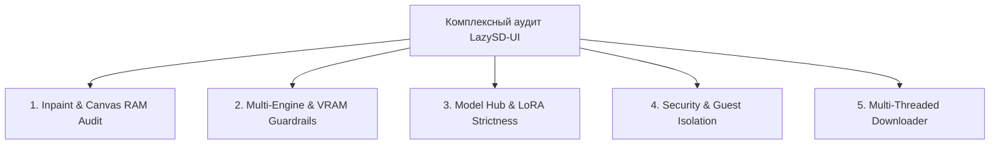

# Техническое задание (ТЗ): Комплексный аудит кодовой базы LazySD-UI

> **Цель аудита:** Полная ревизия стабильности, безопасности, утечек памяти и корректности взаимодействия подсистем WebUI перед переходом проекта из стадии **Pre-Alpha** в **Alpha**.

---

## 1. Контекст: Нужен ли `INPAINT_DEV_GUIDE.md` как план работ?

> [!NOTE]
> **Прямой ответ:** **Нет, как план доработок выполнять его не нужно.**
> Этот документ — ретроспективный гайд форка SnowE22 с описанием их реализации Crop & Stitch для `sd-cli.exe`.

### Сверка фактов:
1. **Masked Window (Crop & Stitch)**: уже реализован в [`backend/masking.py`](file:///G:/QuantFunc-WebUI/backend/masking.py). Настоящая реализация превосходит SnowE22: она мульти-движковая (работает не только со SD.CPP, но и с Nunchaku, OrbitQuant, SDNQ, QuantFunc), имеет 4 режима кропа (`auto`, `parameters`, `manual`, `full`), сохраняет сайдкары и обеспечивает попиксельную точность оригинала вне маски.
2. **Roadmap из раздела 6 гайда**:
   - *Мягкость кисти (Brush Softness)* — **сделано** (двухконтурный курсор превью затухания, ComfyUI-совместимый feathering).
   - *Undo/Redo для штрихов* — **сделано** (история на 12 шагов с защитой от переполнения RAM).
   - *Пресеты для манги* — **сделано** («💬 Текст/SFX», «░ Скринтон», «✒️ Лайнарт», «🖼️ Фон»).
3. **Назначение файла:** [`docs/INPAINT_DEV_GUIDE.md`](file:///G:/QuantFunc-WebUI/docs/INPAINT_DEV_GUIDE.md) остаётся в проекте как **справочная архитектурная документация**.

---

## 2. ТЗ на аудит: Векторы и чек-листы проверки

Аудит разделяется на **5 специализированных векторов**. Каждый вектор поручается соответствующему субагенту-аудитору.

---

### Вектор 1. Inpaint Studio & Canvas Memory Audit

**Ответственный компонент:** `frontend/js/modules/inpaint.js`, `frontend/js/modules/mask-core.js`, `backend/masking.py`.

#### Чек-лист проверки:
1. **Утечки оперативной памяти на 4K+ сканах манги:**
   - [ ] Проверить глубину стека `history` и `future` в `inpaint.js`. При 12 полноразмерных снимках холста 4000×6000 px потребление RAM не должно превышать 600 МБ.
   - [ ] Проверить сборку мусора для скрытых и временных `OffscreenCanvas` / `dataCanvas` при смене исходного изображения.
2. **События мыши / пера (Pointer Capture):**
   - [ ] Проверить, сбрасывается ли флаг `isDrawing = false` при `pointercancel`, `lostpointercapture`, уводя курсора за пределы окна браузера (`window.blur`).
   - [ ] Проверить работу рисования маски со стилусов и планшетов (Wacom, iPad/Sidecar, Huion HS611).
3. **Точность композитинга и кропа (Backend):**
   - [ ] Проверить граничные условия `compute_crop_box`: маска на самом краю изображения (0, 0) или в правом нижнем углу.
   - [ ] Проверить корректность обратной вклейки Lanczos-фильтром: пиксели вне бокса маски должны оставаться абсолютно нетронутыми.
   - [ ] Проверить поведение при пустой маске или полностью белой маске (на весь экран).

---

### Вектор 2. Multi-Engine & VRAM Guardrails Audit

**Ответственный компонент:** `backend/sd_cpp.py`, `backend/extras.py`, `backend/worker.py`, `backend/gpu.py`.

#### Чек-лист проверки:
1. **Переключение моделей и очистка VRAM:**
   - [ ] При переключении с Nunchaku на SD.CPP или OrbitQuant освобождается ли VRAM полностью (`torch.cuda.empty_cache()`, завершение фоновых подпроцессов workers)?
   - [ ] Проверить поведение при нехватке VRAM (симуляция OOM): выводится ли человекопонятная ошибка вместо тихого зависания процесса.
2. **Инъекция системных путей CUDA (`880b058`):**
   - [ ] Проверить корректность поиска DLL (`nvrtc64_*.dll`, `cudart64_*.dll`) на ПК без установленного CUDA SDK (только с драйвером NVIDIA).
   - [ ] Проверить работу на видеокартах с $\le 12$ ГБ VRAM: активируются ли флаги `--backend te=cpu`, `--params-backend cpu`, `--vae-tiling`.
3. **Завершение и отмена генерации:**
   - [ ] При нажатии кнопки «Отмена» корректно ли отправляется `SIGTERM`/`SIGKILL` в дочерний процесс `sd-cli.exe` или Python worker Nunchaku, чтобы процесс не оставался «зомби» в диспетчере задач.

---

### Вектор 3. Model Hub & LoRA Guardrails Audit

**Ответственный компонент:** `backend/hub.py`, `backend/lora.py`, `backend/registry/loader.py`, `LazySD-Models`.

#### Чек-лист проверки:
1. **Безопасность облачного каталога (`backend/hub.py`):**
   - [ ] Проверка на Path Traversal: блокируются ли запросы с именами вроде `../../evil.json`, `models/test.json`, `test.exe`.
   - [ ] Поведение при обрыве связи или недоступности GitHub CDN: корректно ли отдаётся кэшированный `index.json` без падения сервера.
   - [ ] Корректность вызова `reload_registry()`: обновляется ли список моделей без утечек открытых дескрипторов файлов.
2. **Кросс-движковая изоляция LoRA (`target_architecture`):**
   - [ ] Проверить тесты матрицы совместимости:
     - 9B LoRA на 9B Nunchaku $\to$ **100% совместимо**;
     - 9B LoRA на 9B GGUF $\to$ **100% совместимо**;
     - 9B LoRA на 4B Nunchaku $\to$ **Заблокировано**;
     - 9B LoRA на FLUX.3 $\to$ **Заблокировано**;
     - 9B LoRA на Qwen 2.1 $\to$ **Заблокировано**.
   - [ ] Проверить сохранение кастомных привязок архитектур в `models/loras/.lora_meta.json`.

---

### Вектор 4. Security & Multi-User Isolation Audit

**Ответственный компонент:** `app.py`, `backend/accounts.py`, `backend/security.py`, `backend/share.py`.

#### Чек-лист проверки:
1. **Права гостевых сессий (Guest Role):**
   - [ ] Гости **не должны** иметь доступа к:
     - Установке карточек моделей (`POST /api/hub/install`);
     - Удалению файлов и моделей (`DELETE /api/models/{id}/files`);
     - Редактированию настроек (`POST /api/settings`);
     - Запуску туннелей расшаривания (`POST /api/share/start`).
2. **Безопасность сетевого периметра:**
   - [ ] Проверить туннели Cloudflare и Gradio Live на предмет утечки локальных файлов за пределы `outputs/` и статических ресурсов.
   - [ ] Проверить валидацию путей в эндпоинтах скачивания и открытия папок (`validate_path`, `validate_filename`).

---

### Вектор 5. Multi-Threaded Downloader & File Integrity Audit

**Ответственный компонент:** `backend/download/`, `backend/model_files.py`.

#### Чек-лист проверки:
1. **Многопоточность и сборка сегментов:**
   - [ ] Проверить сценарий внезапного обрыва связи: сохраняются ли скачанные `.part_N` файлы и метаданные `.download_meta.json`.
   - [ ] Проверить функцию Resume: возобновляется ли загрузка с точного байта без повторного выкачивания гигабайтов.
   - [ ] Проверить корректность слияния сегментов в финальный файл: совпадает ли размер файла с `Content-Length`.
2. **Очистка временных файлов:**
   - [ ] При отмене или ошибке загрузки удаляются ли временные сегменты `.part_*`, чтобы не забивать диск мусором.

---

## 3. Критерии приёмки и классификация дефектов

Каждый найденный дефект классифицируется по матрице критичности:
- 🔴 **CRITICAL (Блокер):** Приводит к падению сервера, вылету CUDA с невозможностью продолжить работу, утечке произвольных файлов с ПК (LFI/RCE), порче пользовательских файлов.
- 🟠 **HIGH:** Ошибки инференса (OOM при нормальных параметрах), сбои вклейки маски, незавершённые процессы-зомби в диспетчере задач, неработающая кнопка отмены.
- 🟡 **MEDIUM:** Ошибки отображения в UI, сбивающиеся фильтры при обновлении страницы, рассинхронизация бейджей статуса, неоптимальное потребление RAM.
- 🟢 **LOW / TWEAK:** Мелкие косметические неточности, опечатки в подсказках, улучшение читаемости логов.

---

## 4. Рекомендуемый план запуска аудита

1. **Фаза 1 (Безопасность и ядро):** Запуск аудиторов по Векторам 4 (Security) и 3 (Model Hub & LoRA).
2. **Фаза 2 (Инференс и железо):** Запуск аудиторов по Векторам 2 (Multi-Engine & VRAM) и 1 (Inpaint & Canvas RAM).
3. **Фаза 3 (Загрузки и сеть):** Запуск аудитора по Вектору 5 (Downloader).
4. **Фаза 4 (Итоговый отчёт):** Сводная таблица уязвимостей, приоритизация фиксов и составление ТЗ для выпуска первого Alpha-релиза.
